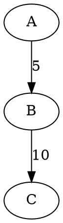

# Graph Edge List to DOT Converter

### Project as a part DSW Ideis University for Graph Theory subject

## Project Description

The aim of this project is to create a Python program that converts a graph from an edge list format into the DOT format used by Graphviz.

The program supports four types of graphs:
- `d` – directed graph
- `g` – undirected graph
- `dw` – directed weighted graph
- `gw` – undirected weighted graph

## Input

The first line contains the graph type and the number of edges. The following lines describe each edge using two vertices, and for weighted graphs, an additional integer weight.

## Output

The program generates a DOT representation of the graph. Directed edges use `->`, while undirected edges use `--`. For weighted graphs, edge weights are added as labels.

## Example

**Input:**
```text
dw 2
A B 5
B C 10
```

**Output:**


The output can be used with Graphviz to visualize the graph.